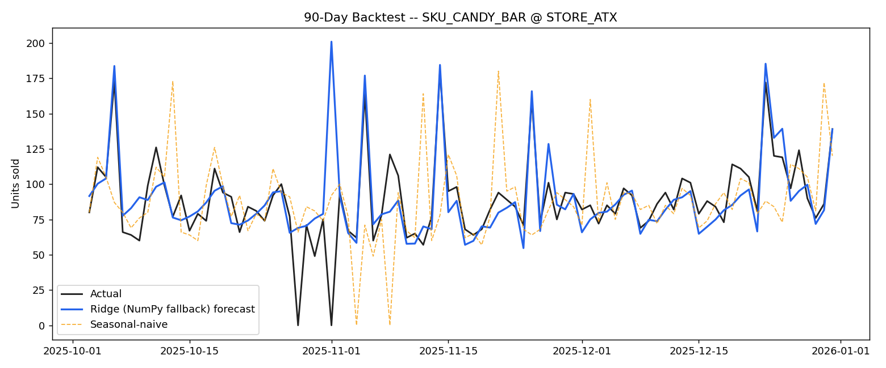

# Demand Forecasting Engine

Daily SKU-level demand forecasting for grocery retail, built to answer the
question every supply-chain team cares about: *how many units will we sell, by
store, by product, over the next planning horizon?* Better forecasts mean fewer
stockouts, less overstock, and tighter working capital.

> This project runs on fully synthetic data (no real or confidential information).
> A data generator simulates realistic retail demand so the pipeline is
> reproducible end-to-end.

## Results

Backtested on a 90-day out-of-sample window across 20 store x SKU series:

| Metric | ML model | Seasonal-naive baseline |
|---|---|---|
| WAPE | **15.8%** | 28.6% |
| MAPE | **13.6%** | — |

**The model cuts forecast error by ~45% versus a seasonal-naive baseline.**
Every model is measured against that honest benchmark — a forecast that isn't
compared to naive isn't telling you anything.



*Blue = model forecast, black = actual demand, orange dashed = seasonal-naive.
The model tracks promo and holiday spikes that the naive baseline misses.*

## How it works

```
generate_data.py  ->  data/sales.csv  ->  forecast.py  ->  outputs/
```

1. **Synthetic data** (`generate_data.py`) — 3 years of daily sales across 4
   stores and 5 SKUs, with trend, yearly + weekly seasonality, promo lift,
   holiday spikes, Poisson noise, and occasional stockout days.
2. **Feature engineering** — calendar features (day-of-week, month, week-of-year),
   lag features (1/7/14/28-day), rolling mean/std windows, plus promo and holiday
   flags.
3. **Modeling** — a gradient-boosted regressor with an automatic backend:
   LightGBM if installed, else scikit-learn `HistGradientBoosting`, else a
   dependency-free NumPy ridge regression. The project runs anywhere.
4. **Backtesting** — a strict time-based holdout (last 90 days) with no leakage,
   evaluated on **WAPE, MAPE, bias, and RMSE** — the metrics supply-chain
   planners actually track.

## Quickstart

```bash
pip install -r requirements.txt
python generate_data.py      # writes data/sales.csv
python forecast.py           # writes outputs/backtest_metrics.csv + chart

# forecast a single series
python forecast.py --sku SKU_COLA_12PK --store STORE_ATX
```

## Why these choices

- **WAPE over plain MAPE** — MAPE explodes on low/zero-demand days (division by a
  tiny number). WAPE weights by volume and is the metric most retail planning
  systems report.
- **Bias is tracked explicitly** — a forecast can have great accuracy but a
  systematic lean. Persistent over-forecasting inflates inventory; under-forecasting
  drives stockouts. Bias catches that.
- **Seasonal-naive baseline** — if a model can't beat "same day last week," it
  isn't earning its complexity.

## Repo structure

```
demand-forecasting-engine/
├── generate_data.py        # synthetic data generator
├── forecast.py             # features, models, backtest, metrics, charts
├── requirements.txt
├── data/                   # generated sales.csv lands here
└── outputs/                # backtest_metrics.csv + forecast_backtest.png
```

## Next steps / extensions

- Add probabilistic forecasts (quantile loss) to drive safety-stock decisions.
- Hierarchical reconciliation so store-level forecasts sum to chain totals.
- Promo-uplift modeling as a dedicated feature pipeline.
